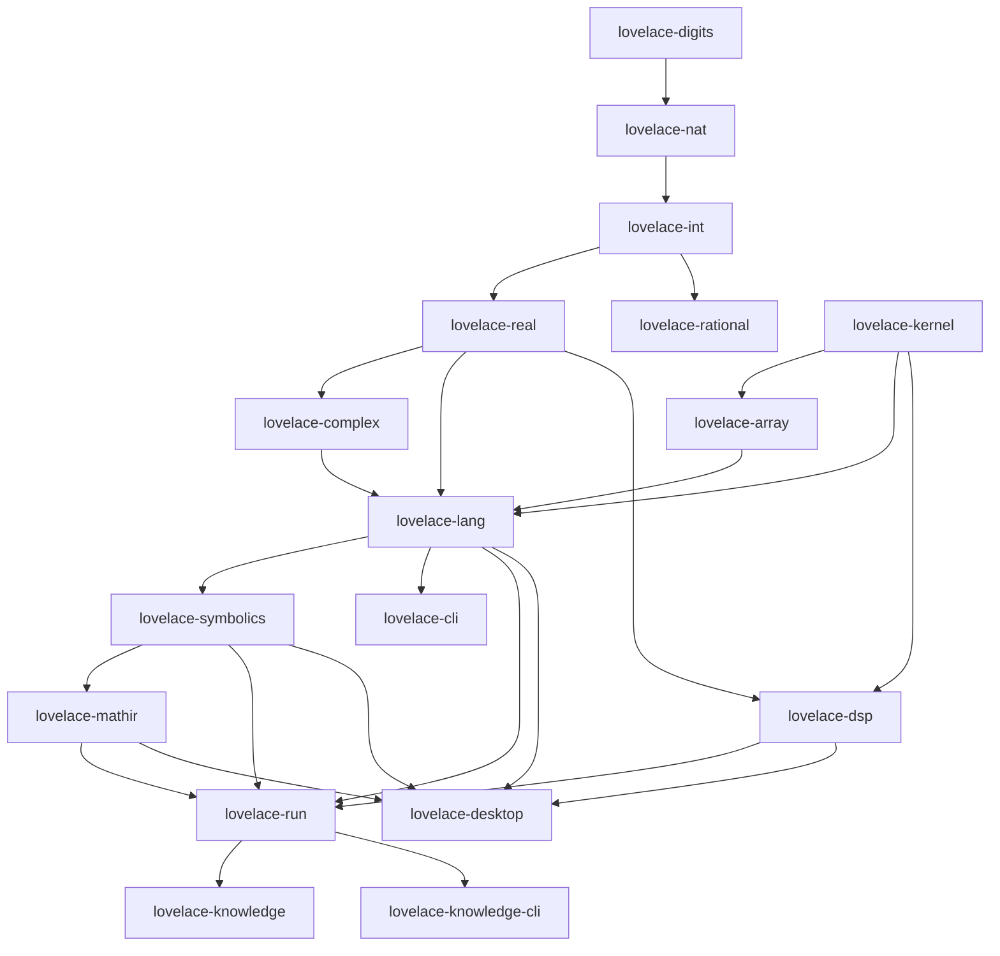

# Requirements: LovelaceSharp → Rust (Whole-Stack Port)

> Scope: the authoritative, dependency-ordered requirements for porting **every project** of the
> LovelaceSharp solution — the arbitrary-precision numeric tower, the generic array library, the
> scripting engine, the symbolic kernel, MathIR, DSP, the three front-ends, the knowledge tooling
> and the Lean proofs — to a single Rust workspace, replacing the browser IDE with a native desktop
> application, and enforcing behavioural parity by machine rather than by review. This is a **lifted
> specification**: every number and constraint below was taken from the implemented system, and the
> document is the contract a port is measured against. It is a requirements document for review —
> no implementation yet.

---

## At a glance

| Fact | Measured value | Source |
|---|---|---|
| C# projects in the solution | 18 source projects + 15 test projects + 3 benchmark projects | `LovelaceSharp.slnx` |
| Hand-written source to port | ≈ 42 900 lines (65 633 measured, minus the 22 726-line vendored CodeMirror bundle that the desktop app deletes) | line count per project |
| Test facts to disposition | 2 087 `[Fact]/[Theory]` | census over `*.Tests` |
| Machine-verified language examples | 214 (111 `Language.md` + 103 `Lovelace.Symbolics/README.md`) | fence count |
| Golden protocol envelopes | 20 `.ls` + 20 `.json` | `Lovelace.Run.Tests/fixtures` |
| Plugin builtins | 59 symbolic + 16 DSP + 5 MathIR | plugin registration tables |
| Target crates | 18 + a parity harness crate | §4 |
| Phases | 9 (P0–P8) | §12 |
| Blocking gates | 9 (build, lint, dependency, unit, corpus, census, wire, desktop, proofs) | §10 |

---

## 1. Goals and non-goals

### Goals

| # | Goal |
|---|---|
| G1 | One Cargo workspace replaces the .NET solution; one `cargo build` produces every binary. |
| G2 | **Observable behaviour is preserved** on the five parity levels of [Lovelace.Rust.Parity.md](Lovelace.Rust.Parity.md) §2: values, rendering, diagnostics, wire protocol, artifacts. |
| G3 | A native desktop IDE replaces `Lovelace.Studio`; the HTTP surface and the browser runtime are deleted ([Lovelace.Rust.Desktop.md](Lovelace.Rust.Desktop.md)). |
| G4 | The agent-facing `Lovelace.Run` wire protocol stays compatible, so an external harness needs no change. |
| G5 | The Lean proofs remain the formal anchor, and the Rust implementation gains test-level instances of every named theorem. |
| G6 | Performance meets or beats the recorded C# baselines on the existing benchmark suite; the exemptions are written down. |
| G7 | The numeric core contains **no floating point**: arbitrary precision end to end, as the project's thesis requires. |
| G8 | The port is executable incrementally: every crate is independently testable, and the C# tree stays runnable until cutover. |
| G9 | The repository after cutover has one language in the product tree, one test runner, one build tool, and no toolchain that requires a runtime installation. |
| G10 | Every intentional divergence from C# is recorded as a decision with a frozen oracle entry — nothing is dropped silently. |

### Non-goals

| # | Non-goal | Rationale |
|---|---|---|
| N1 | Byte-identical internal representation (BCD vs binary limbs) | Parity is observable behaviour; forcing BCD into Rust would import the exact performance tax the repository has already measured and rejected (§2.2). |
| N2 | Preserving .NET generic-math interfaces | `INumber<T>` is a .NET concept; Rust traits carry the equivalent contracts where they pay for themselves. |
| N3 | Preserving the Studio HTTP API | The desktop app has no HTTP surface; its tests are deliberately not ported, with a recorded reason (Parity §6). |
| N4 | Runtime-loadable plugins (`.so`/`.dll`) | C# plugins are compile-time linked; Rust keeps the same model with crate-level plugin crates. |
| N5 | Rewriting the Lean proofs in Rust | The proofs are language-independent statements about base-`b` digit arithmetic; porting them would weaken them. |
| N6 | Feature additions during the port | New features during a parity migration destroy the oracle. They queue behind cutover. |
| N7 | Mobile or wasm targets | Out of scope; the desktop app is the only new target. |
| N8 | A second GUI toolkit behind an abstraction layer | One toolkit, decided and reversible only by an ADR (§3.5). |

---

## 2. What "port" means here

### 2.1 Frozen surface

The observable surface is defined in [Lovelace.Rust.Parity.md](Lovelace.Rust.Parity.md) §2 (P0–P5).
Everything on those levels is frozen against the C# tree tagged `oracle-v1`. Everything else is
engineering freedom, and the port is expected to use it.

### 2.2 Free internals, with the evidence

| Internal choice | C# today | Rust target | Why it is free | Evidence |
|---|---|---|---|---|
| Digit representation | BCD, two decimal digits per byte | Binary limbs, base 2⁶⁴, plus a decimal cache | Only decimal text, values and kinds cross the boundary; `DigitStore` is internal to the tower | Measured: add 17×, sub 13×, div 298×, mul 20× (100 digits) versus BCD; the decimal cache restores parse/tostring to 23×/181× faster than BCD (`benchmark-results.md`) |
| Allocation | `ArrayPool` rentals, `IDisposable` snapshots | Plain `Vec` plus scratch buffers owned by the caller | No observable difference; the absence of a GC removes the rental dance | `Natural.cs` rental paths exist only to avoid GC pressure |
| Precision scoping | `AsyncLocal<long?>` flow-local | Explicit `Precision` threaded through an evaluation context | The scope is observable only through results, which are still compared | `Real.WithPrecision` / `WithLocalPrecision` |
| Parallelism | `Parallel.For`, `Task.Run` | `rayon` with the same thresholds | Reductions are exact and order-independent by construction | 12 parallel sites in `Natural`, `Real` and `DigitStore` |
| Error transport | Exceptions | `Result` plus one message catalogue | Messages and codes are compared; the mechanism is not | `Diagnostic` contract, `code`/`category` |
| Module layout | One project per class | One crate per project (§4) | Names are not observable | — |

**The representation decision is the single most consequential freedom**, and it is taken
deliberately: the repository has already specified and measured a binary-limb rewrite
(`.github/requirements/Lovelace.Natural.BinaryLimb.md`) and recorded the crossover where decimal
conversion hurts. The Rust port adopts binary limbs *with* the decimal cache from the start, and
proves the mapping to the Lean model under Parity PR-3.

### 2.3 What must NOT be optimised away

| Invariant | Why it is load-bearing |
|---|---|
| Period detection in division | `1/3` is `0.(3)` — the product's defining behaviour |
| Exactness propagation (`IsExact`) | Results carry provenance; inexactness propagates through evaluation |
| Canonical term order in Symbolics | Canonical form is compared as text and is the contract of every symbolic result |
| Structured projection totality | Every kind projects; an absent value projects to `Null`, never to nothing |
| Ordering of published collections | `variables[]` and `functions[]` are ordered; an agent indexes them |
| Diagnostic offsets as UTF-16 units | A consumer slices the caller's text with the published position |
| Determinism under threading | The same script must produce identical bytes on any thread count |

---

## 3. Target platform

| ID | Requirement |
|---|---|
| TP-1 | Rust **edition 2024**, MSRV **1.85** (the edition's stabilization release). Raising the MSRV requires an ADR. |
| TP-2 | One workspace, `resolver = "3"`, shared `[workspace.dependencies]` and `[workspace.lints]`; no crate pins its own versions of shared dependencies. |
| TP-3 | Supported targets: `x86_64-pc-windows-msvc`, `x86_64-unknown-linux-gnu`, `aarch64-apple-darwin`. Others are best-effort. |
| TP-4 | `forbid(unsafe_code)` in every crate except where a documented, audited exception exists (expected: none in the numeric tower). A workspace lint enforces it. |
| TP-5 | **No floating point in the numeric value path.** `f32`/`f64` are permitted only in plotting geometry and UI layout, behind a documented allowlist; a CI check enforces the allowlist. |
| TP-6 | Dependencies are licence-audited (MIT/Apache-2.0/BSD only), advisory-audited, and justified in a committed dependency document. No dependency may pull a network, async-runtime or database stack into the engine. |
| TP-7 | The engine is **synchronous**. No async runtime in `lovelace-lang` and below; callers run it on whatever thread or pool they own. |
| TP-8 | Plugins are ordinary crates linked by the host, mirroring the compile-time plugin model; hosts opt in explicitly, exactly as `LoadPlugin` does today. |
| TP-9 | Binaries: `lovelace` (REPL), `lovelace-run` (wire runner), `lovelace-knowledge` (MGIR CLI), `lovelace-desktop` (GUI). Each is a thin `main` over a library entry point that tests can call. |
| TP-10 | Every public item is documented; library crates deny `missing_docs`. |

### 3.5 Desktop toolkit

Decided in [Lovelace.Rust.Desktop.md](Lovelace.Rust.Desktop.md) §3: `egui`/`eframe`, gated by a Phase D0
spike, with Tauri 2 as the documented fallback. No second toolkit is to be introduced behind an
abstraction layer.

---

## 4. Surface inventory and crate mapping

One crate per C# project. The one-to-one rule is what makes the parity census mappable and keeps a
reviewer's mental model intact; the two exceptions are called out below.

| # | C# project | Rust crate | Lines | Tests | Oracle | Phase |
|---|---|---|---|---|---|---|
| 1 | `Lovelace.Representation` | `lovelace-digits` | 696 | 86 | O2 | P1 |
| 2 | `Lovelace.Natural` | `lovelace-nat` | 1 723 | 156 | O2, O5 | P1 |
| 3 | `Lovelace.Integer` | `lovelace-int` | 720 | 143 | O2, O5 | P1 |
| 4 | `Lovelace.Real` | `lovelace-real` | 4 244 | 285 | O2, O5 | P2 |
| 5 | `Lovelace.Rational` | `lovelace-rational` | 300 | 0 | O1 | P2 |
| 6 | `Lovelace.Complex` | `lovelace-complex` | 1 344 | 92 | O2 | P3 |
| 7 | `Lovelace.Array` | `lovelace-array` | 720 | 19 | O2 | P3 |
| 8 | `Lovelace.Abstractions` | `lovelace-kernel` | 1 427 | 33 | O2 | P3 |
| 9 | `Lovelace.Statistics` | `lovelace-stats` | 37 | 0 | O1 | P3 |
| 10 | `Lovelace.Suite` | `lovelace-lang` | 8 485 | 435 | O1, O2 | P4 |
| 11 | `Lovelace.Symbolics` | `lovelace-symbolics` | 13 980 | 498 | O1, O2 | P5 |
| 12 | `Lovelace.MathIR` | `lovelace-mathir` | 1 279 | 0 | O2 | P5 |
| 13 | `Lovelace.Dsp` | `lovelace-dsp` | 1 276 | 61 | O2 | P5 |
| 14 | `Lovelace.Console` | `lovelace-cli` | 608 | 15 | O2 | P6 |
| 15 | `Lovelace.Run` | `lovelace-run` | 1 520 | 215 | O3, O6 | P6 |
| 16 | `Lovelace.Knowledge` | `lovelace-knowledge` | 1 651 | 18 | O2, O6 | P6 |
| 17 | `Lovelace.Knowledge.Run` | `lovelace-knowledge-cli` | 230 | 0 | O6 | P6 |
| 18 | `Lovelace.Studio` | `lovelace-desktop` | 25 393 (2 667 hand-written) | 22 | O1–O3 | P7 |
| 19 | `Lovelace.Proofs` | `proofs/` (Lean, unchanged) | — | — | O5 | P8 |

**Two deviations from one-to-one are explicit**: `lovelace-kernel` absorbs the Modus plugin seam
(`IModusPlugin`/`IModusContext`/`IField`) because it is the contract between the engine and its
plugins; `lovelace-stats` stays separate despite being 37 lines because it is an *opt-in plugin* and
its separateness is the point. Nothing else merges.

**Coverage holes to close, not inherit:** `Lovelace.Rational` and `Lovelace.MathIR` have **no test
project** in C#. Both are covered only indirectly. The port must add direct suites and record them as
`new` manifest entries (Parity §6), because silently inheriting a hole is how a port regresses.

### Dependency graph

---

## 5. Crate requirements

The **functional specification for each crate already exists**: the per-project requirements under
`.github/requirements/` (`Lovelace.Natural.md`, `Lovelace.Integer.md`, `Lovelace.Real.md` and its
Sqrt/Pi/Precision siblings, `Lovelace.Array.md`, `Lovelace.Suite.md`, `Lovelace.Suite.Arrays.md`,
`Lovelace.Representation.md`, `Lovelace.Proofs.md`, `Lovelace.Console.md`, `Lovelace.Studio.md` and
`Lovelace.Studio.Sessions.md`) specify the required behaviour in detail and are **inherited unchanged
by the port**. This document does not restate them.

What follows is the Rust-specific delta: what the port must decide, replace or add. Each checklist is
*in addition to* the blanket rules — port every C# test (Parity §6), pass its share of the corpus, and
satisfy the workspace lints.

### 5.1 `lovelace-digits`

- [ ] Digit storage with a canonical form (no leading zeros, zero is empty) and no sentinel-byte protocol leaking into the API. [prerequisite for `lovelace-nat`]
- [ ] O(1) digit get/set equivalent to `GetDigit`/`SetDigit` over the public surface. [depends on canonical form]
- [ ] Bulk operations (compare, trim, copy, clear) with the same semantics the tower relies on. [depends on O(1) access]
- [ ] No locks in the hot path. C#'s per-instance monitor exists because of mutable sharing; Rust solves that with ownership. [mandatory — the lock is a port artefact, not a requirement]
- [ ] An explicit decision recorded: keep the crate at all, or fold it into `lovelace-nat` once the binary-limb representation lands. [depends on the representation decision, §2.2]

### 5.2 `lovelace-nat`

- [ ] Constructors and parsers equivalent to the C# surface, including span parsing and negative-input rejection. [prerequisite for `lovelace-int`]
- [ ] Add, subtract (underflow is an **error**, never a silent widening), multiply, divide, remainder, power, factorial. [depends on constructors]
- [ ] Division returns quotient and remainder with the same bounded-remainder contract as `DivRem` and the Lean `divDigits_correct` theorem. [depends on divide]
- [ ] Decimal parse/format with the divide-and-conquer algorithm **and** the lazy decimal cache, so `Real`'s string round-trips stay off the hot path. [mandatory — this is the measured reason the binary representation is viable]
- [ ] `mul_pow10(k)` (`ShiftLeftDecimal`) exposed because `lovelace-real` calls it in non-periodic division. [prerequisite for `lovelace-real`]
- [ ] Parallel multiplication above the recorded threshold, with an order-independent reduction so results are deterministic across thread counts. [depends on multiply]
- [ ] Display parity: no grouping separators, no sign on zero, exact digit text. [mandatory — P1]

### 5.3 `lovelace-int`

- [ ] Sign-magnitude representation with zero always positive (no negative zero). [prerequisite for `lovelace-real`]
- [ ] Sign-aware arithmetic delegating magnitude work to `lovelace-nat`. [depends on representation]
- [ ] Signed `divrem` with truncation semantics identical to C#, including the sign of the remainder. [depends on arithmetic]
- [ ] Parsing and formatting parity, including the negative-zero edge case. [mandatory — P1]

### 5.4 `lovelace-real`

- [ ] Exponent and period metadata exactly as `Real` models them, with canonical period detection (shortest period, shortest pre-period). [prerequisite for the whole engine]
- [ ] **Precision as an explicit parameter**, not an ambient scope: every operation that depends on precision takes it. [mandatory — removes the `AsyncLocal` risk class]
- [ ] `sqrt` by Newton–Raphson with progressive precision doubling and a correct final rounding rule. [depends on precision threading]
- [ ] `pi` by Chudnovsky with binary splitting, honouring the computation cap and reporting progress. [depends on sqrt, whose tests pin shared edge cases]
- [ ] Exactness propagation: an inexact input yields an inexact result; identity cases keep their documented exactness. [mandatory — P0]
- [ ] Formatting parity: `0.(3)`, `0.1(6)`, ASCII versus Unicode glyph modes, and the display-precision truncation rule. [mandatory — P1]
- [ ] Heavy numeric tests (the 1 000-digit `Category=Heavy` cases) preserved behind a feature flag, not deleted. [depends on sqrt/pi]

### 5.5 `lovelace-rational` and `lovelace-complex`

- [ ] Rational: normalized fraction, positive denominator, gcd 1, division-by-zero error, repeating-decimal rendering. [prerequisite for `lovelace-symbolics`]
- [ ] Complex: three tiers (arbitrary precision, and the fixed-width 19- and 38-digit fast paths) where the fast path is **bit-identical** or promotes — never rounds. [depends on `lovelace-real`]
- [ ] Argument provenance: an inexact argument yields an inexact result, including identity cases. [mandatory — P0]
- [ ] Fixed-width tiers promoted to arbitrary precision rather than saturating, with promotion observable only through exactness. [depends on tiers]
- [ ] New direct test suite for Rational (closing the C# hole) and the existing 92 complex tests ported. [depends on PF freeze]

### 5.6 `lovelace-array`

- [ ] Generic N-dimensional array equivalent: shape, strides, indexing, multi-index slicing, partial indexing. [prerequisite for `lovelace-lang`]
- [ ] Shape algebra: reshape, transpose, squeeze/expand, flatten, concat, append — with the same error conditions. [depends on indexing]
- [ ] Element-wise arithmetic with scalar broadcast over an element-field abstraction equivalent to `IField<T>`. [depends on array]
- [ ] Linear algebra: dot, cross, matmul, det, inv, trace — exact, no floating point. [depends on element-wise ops]
- [ ] Rank-0 and length-zero dimension handling preserved, including the `len` contract the C# suite pins. [mandatory — a documented edge case]

### 5.7 `lovelace-kernel`

- [ ] Plugin seam equivalent to `IModusPlugin`: register builtins, array builtins, scalar payload conversion. [prerequisite for every plugin crate]
- [ ] Payload conversion owned by the **kernel**, never by plugins — the invariant that keeps plugins free of engine types. [mandatory — architectural invariant]
- [ ] Descriptor metadata (category, summary, arity, variadic, return kind, related, examples) as first-class registration data, since help, autocomplete and the wire registry all derive from it. [depends on seam]
- [ ] Per-load session state: a plugin loaded into an engine gets its own state, so two engines cannot answer from each other's assumptions. [mandatory — the `SymbolicsPlugin` precedent]
- [ ] Argument-contract errors carrying function, expected/actual arity, parameter, expected shape and arrived kind, so the wire `signature` block can be built without parsing messages. [depends on descriptors]

### 5.8 `lovelace-lang`

- [ ] Tokenizer with the same token kinds, the same numeric/string/interpolated-string scanning, and **the same UTF-16 offsets** in `Token::position`. [prerequisite for everything above it]
- [ ] Parser producing an AST equivalent to `Ast.cs`, including ranges binding tighter than arithmetic and the documented precedence table. [depends on tokenizer]
- [ ] Interpreter with statement-positioned diagnostics, per-statement timings, cancellation checks at statement boundaries, and the `_` result variable. [depends on parser]
- [ ] Value type covering all fourteen kinds, with the widening lattice `Natural → Integer → Real` and non-widening domain kinds (`Complex`, `Symbolic`, `Record`, `Domain`, `Enum`). [depends on interpreter]
- [ ] Engine façade equivalent to `SuiteEngine`: evaluate, variables, functions, revision, diagnostics, last plot, precision, unicode mode, help service, structured projection, typed formatting. [depends on value]
- [ ] Allocation and depth budgets (`ArrayAllocationBudget`, `AstDepth`, `ValueDepth`, `InputDepth`) with the same refusal behaviour and messages. [depends on engine]
- [ ] Atomic publication per evaluation: a failed statement leaves committed state intact and never a half-mutated scope. [mandatory — the desktop's cancel semantics depend on it]
- [ ] Full core builtin set with descriptors, including the array reductions with `axis`, and the help catalogue. [depends on engine]
- [ ] SVG plot renderer with the same model, series semantics, spline-versus-linear rule, tick generation and deterministic output structure. [depends on engine]

### 5.9 `lovelace-symbolics`

- [ ] Hash-consed immutable expressions with per-context interning; identity is structural and **ids are never persisted** (names are). [prerequisite for canonical behaviour]
- [ ] Canonical ordering as a hand-written total order with **no hash dependence**. [mandatory — canonical form is compared as text]
- [ ] Assumption store scoped per plugin load, with contradiction detection and an unsatifiable sentinel distinct from empty. [depends on expressions]
- [ ] Printing in both modes with budget and truncation reporting, matching the published string format exactly. [depends on ordering]
- [ ] The 59 builtins: calculus (8), algebra (9), solving and compilation (8), numeric and print (2), construction and domains (7), assumptions and logic (11), elementary functions (14), plus the matrix and inspection bridges. [depends on all of the above]
- [ ] Rewrite engine with budgets, step traces and status reporting; simplification bounded as today. [depends on printing]
- [ ] Solve/limit/integrate/optimize result records with the exact field order and enum spellings the wire fixtures pin. [mandatory — P3]
- [ ] Doc-sync: the README examples remain machine-verified against the Rust engine (Oracle O1). [depends on builtins]

### 5.10 `lovelace-mathir`

- [ ] IR node set (35 operation kinds) and the text format header `#!mathir 2` with the same acceptance and refusal rules. [prerequisite for compilation]
- [ ] Lowering that erases assumptions and shares common subexpressions. [depends on IR]
- [ ] Typing: inference, then validation at compile time. [depends on lowering]
- [ ] Evaluator with the same precision policy (caller-supplied, guard-digit cap) and per-call memo arrays. [depends on typing]
- [ ] Five builtins (`lower`, `compile`, `compile_full`, `evalir`, `evalir_batch`) plus batch row-width validation and cancellation between rows. [depends on evaluator]
- [ ] New direct test suite (closing the C# hole) covering typing, refusal and batch contracts. [depends on PF freeze]

### 5.11 `lovelace-dsp`

- [ ] 16 builtins (`conv`, `dft`, `fft`, `filter`, `movingavg`, the signal constructors, `delay`, `scale`, `re`/`im`/`conj`) with identical argument-position semantics. [prerequisite for host wiring]
- [ ] Fixed-width fast path with silent promotion; results bit-identical to the arbitrary-precision path. [depends on complex tiers]
- [ ] Cancellation polled per element through an explicit token, not an ambient one. [depends on builtins]
- [ ] `noise` argument-position ambiguity (3-argument count form versus 4-argument seed form) **resolved as a recorded decision in P0**, before the kernel is written. [mandatory — an ambiguity ported as-is is a defect generator]
- [ ] No floating point anywhere in the DSP path. [mandatory — G7]

### 5.12 `lovelace-cli`

- [ ] REPL with line editing and history, multi-line accumulation, and the `_` result print. [depends on the engine]
- [ ] Commands and help output preserved, including the precision command if the current binary exposes it. [depends on REPL]
- [ ] Non-interactive `--eval`/`--file` parity with the runner's evaluation semantics. [depends on REPL]

### 5.13 `lovelace-run`

- [ ] The full argv contract, including terminal `--help` and exit codes 0/1/2. [prerequisite for the wire gate]
- [ ] Envelope preamble (protocol version, symbolic format version, MathIR version, `ok`) and every success and failure field with the same presence rules. [depends on argv]
- [ ] Omission semantics: absent fields are **omitted**, never null; `artifacts` is present and possibly empty. [mandatory — projection fixtures compare presence]
- [ ] Registry query modes (`--functions`, `--function`) as reads of the live registry, with `total/returned/truncated`. [depends on envelope]
- [ ] Byte-level JSON rendering: non-ASCII escaped as `\uXXXX`, compact single document, one trailing newline, nothing else on stdout. [mandatory — P3, and the reason a custom serializer is required]
- [ ] UTF-16 offset translation from the engine's text to the caller's text, including BOM and CRLF handling. [depends on envelope]
- [ ] The 20 golden envelopes reproduced structurally, and the stdout-purity test through the real process. [depends on all of the above]

### 5.14 `lovelace-knowledge` and `lovelace-knowledge-cli`

- [ ] Pipeline stages (sample, canonicalize, reduce, converge, persist, query) with the same seeded determinism (SplitMix64, seed 20240617). [prerequisite for the end-to-end oracle]
- [ ] Six CLI commands (`config`, `sample`, `reduce`, `converge`, `query`, `help`) over JSON stdio with the same exit codes. [depends on pipeline]
- [ ] Runner spawning and observation canonicalization identical to today, so the recorded graph is reproducible. [depends on CLI]
- [ ] Graph persistence version 1 readable by the Rust tool. [depends on pipeline]

### 5.15 `lovelace-desktop`

See [Lovelace.Rust.Desktop.md](Lovelace.Rust.Desktop.md). This crate is the only place where a
widget toolkit is a dependency, and the only place where the application owns threads.

### 5.16 `proofs/`

- [ ] Lean project carried over with the pinned toolchain and no Mathlib. [mandatory — G5]
- [ ] Every named theorem mapped to a Rust property test (Parity PR-2). [depends on the numeric crates]
- [ ] Exhaustive small-case enumeration in CI (Parity PR-4). [depends on the mapping]

---

## 6. Wire compatibility at a glance

The full contract lives in Parity §2.1 and §9 and in the runner crate's requirements; the invariants
that must never drift are:

| Invariant | Consequence if broken |
|---|---|
| `position` is a 0-based **UTF-16** offset into the caller's text | An agent slices the wrong substring |
| Non-ASCII is escaped as `\uXXXX` | Byte-level consumers and fixtures disagree |
| Absent fields are omitted, never null | Consumers cannot distinguish "none" from "empty" |
| `artifacts` is present (possibly empty) on success **and** post-engine failure | A written plot becomes invisible |
| `print` never reaches stdout | The envelope stops parsing |
| Exit codes 0/1/2 with usage errors on stderr | Harnesses misclassify a usage error as a script error |
| Registry metadata is omitted when unregistered | "No summary" becomes indistinguishable from an empty summary |

---

## 7. Desktop pivot, in one paragraph

The Studio's twelve REST routes become in-process commands; its four panes, session-per-tab model,
precision knob, incremental execution, progress-and-cancel model, symbolic inspector and autocomplete
are preserved as behaviour while its transport is deleted. The app gains what a desktop program should
have had all along: real files, recent files, dirty-state handling, native menus and shortcuts,
persisted layout and crash recovery. Requirements and acceptance tests:
[Lovelace.Rust.Desktop.md](Lovelace.Rust.Desktop.md).

---

## 8. Parity programme, in one paragraph

The C# tree is frozen at `oracle-v1` and becomes executable specification. Six existing oracles —
214 doctests, 2 087 test facts, 20 golden envelopes, seven benchmark suites, the Lean proofs, and the
seeded MGIR behavioural graph — are bound to the Rust workspace through a language-neutral corpus, a
census-plus-manifest ledger, a differential harness, twelve property laws, artifact comparison rules
and a fail-closed scorecard. The gate is itself falsified with twelve seeded mutations before anyone
trusts it. Requirements and thresholds: [Lovelace.Rust.Parity.md](Lovelace.Rust.Parity.md).

---

## 9. Performance

| Benchmark | Measures | Baseline artefact | Gate |
|---|---|---|---|
| `bench` | add/sub/mul/div/pi/pow/factorial/tostring/parse at 100–100 000 digits | `benchmark-results.md` | ≥ 0.80× of the C# binary-limb build where one exists, ≥ 1.0× of BCD elsewhere |
| `mulbench` | balanced multiply to 2 000 000 digits | `benchmark-results.md` | ≥ 0.80× |
| `realbench` | Real versus fixed-width versus `double` dispatch | harness output | ≥ 0.80× |
| `precbench` | accuracy at 8 and 16 digits versus `float`/`double` | `precbench-report.md` | Exact-match rate must equal C#; latency ≥ 0.80× |
| `dspbench` | fixed-width complex ops, convolution, FIR | `dspbench-report.md` | ≥ 0.80× |
| `symbench` | 12 symbolic classes (construction, simplify, calculus, polynomials, solve, printing, compile, MathIR, help) | `benchmarks/symbench-baseline.md` | ≥ 0.80× |
| `arraybench` | typed versus boxed array ops at 1K–10M elements | `docs/architecture/typed-array-benchmark-*.md` | ≥ 0.80× |

Recording discipline: the C# numbers are re-measured on the reference machine at freeze time (the
committed artefacts were recorded on other hardware), and every published table states the machine,
the build profile and the date.

---

## 10. Quality gates

| Gate | Check | Blocking |
|---|---|---|
| Build | `cargo build --workspace --release` on three targets | Yes |
| Lint | `cargo fmt --check`, `clippy -D warnings`, workspace lints (no unsafe, floating-point allowlist, docs) | Yes |
| Dependency | `cargo-deny`: licences, advisories, banned crates | Yes |
| Unit | `cargo test --workspace`, fast profile | Yes |
| Heavy | `cargo test --features heavy --release` | Nightly |
| Corpus | 214 examples, 100 % | Yes |
| Census | manifest resolves every entry; `dropped` non-increasing | Yes |
| Wire | 20 golden envelopes plus stdout purity through a real process | Yes |
| Differential | 5 000-case slice per PR, 100 000-case nightly | Yes / nightly |
| Desktop | `T-D` suite on three platforms; no-listener test | Yes from P7 |
| Proofs | Lean build plus theorem instances | Yes |
| Benchmarks | within thresholds, published table | Weekly and release |

---

## 11. Risks

The parity-specific risks (UTF-16 offsets, escaping, task-local precision, map ordering, decimal
conversion, whitespace predicates, parallel reductions, SVG geometry, weakened ported tests, oracle
buildability, message drift, term ordering, DSP ambiguity, oracle rot) are registered in
[Lovelace.Rust.Parity.md](Lovelace.Rust.Parity.md) §13 and are not repeated here. The port-level risks
are:

| ID | Risk | Likelihood | Impact | Mitigation |
|---|---|---|---|---|
| P-R1 | Scope: about 43 000 hand-written lines across 18 crates is a multi-month effort that stalls halfway. | High | High | Phase ordering by dependency, each phase independently shippable as a library, cutover only at the end — the C# tree keeps working throughout. |
| P-R2 | The symbolic kernel (14 k lines, 137 public types, 498 tests) is the long pole and is treated as "just another crate". | High | High | It gets its own phase (P5), its own parity slice, and no other work is scheduled inside it. |
| P-R3 | The desktop app is scheduled as the last 10 % and becomes 40 % of the effort. | High | High | Framework spike fails early and cheaply; the fallback is recorded before UI work starts. |
| P-R4 | Two implementations drift because the C# tree keeps getting feature work. | High | High | Freeze protocol PF-1..5 with amendment records. |
| P-R5 | The port is "done" when tests are green but the product is slower. | Medium | High | Performance is a gate (§9), not a report. |
| P-R6 | Rust's type system tempts a redesign that changes behaviour ("while we're here"). | Medium | High | N6: no features during the port; every behavioural change needs a freeze amendment. |
| P-R7 | The team loses the rationale for C# quirks and "cleans them up". | Medium | High | Quirks are documented as requirements (period detection, exactness, term order, ordering, offsets) and pinned by corpus entries. |
| P-R8 | Licensing of the ported code and dependencies is not reviewed. | Low | High | Dependency licence policy TP-6; the repository's own licence confirmed before publication. |
| P-R9 | Binary size or startup regressions make the desktop app feel heavy against a Native AOT baseline. | Medium | Medium | Budgets in Desktop §15, measured at each phase. |
| P-R10 | The Lean toolchain rots while the port proceeds. | Medium | Medium | Nightly Lean build from P0; pinned toolchain file in the repository. |

---

## 12. Roadmap

| Phase | Scope | Exit criteria |
|---|---|---|
| **P0 — Freeze and harvester** | Tag `oracle-v1`; extract the corpus; take the census; scaffold the manifest; build the two oracle binaries and the differential harness; re-measure baselines on the reference machine; resolve the `noise` ambiguity. | Corpus and census committed; the harness runs one request end-to-end and **can fail**; baselines recorded with machine and date. |
| **P1 — Integers** | `lovelace-digits`, `lovelace-nat`, `lovelace-int`. | 385 ported tests green; Lean instances for representation, add, sub, mul, div; arithmetic benchmarks within threshold. |
| **P2 — Reals** | `lovelace-real`, `lovelace-rational`. | 285 ported tests plus new rational suite; period corpus 100 %; heavy sqrt/pi tests green; accuracy gates equal to C#. |
| **P3 — Arrays and complex** | `lovelace-complex`, `lovelace-array`, `lovelace-kernel`, `lovelace-stats`. | 144 ported tests green; shape-algebra properties green; the kernel seam hosts a trivial plugin. |
| **P4 — Language** | `lovelace-lang`: tokenizer, parser, interpreter, engine, builtins, plotting. | 435 ported tests green; **corpus 100 %**; plot structure gate green; determinism law green. |
| **P5 — Symbolic and signal** | `lovelace-symbolics`, `lovelace-mathir`, `lovelace-dsp`. | 559 ported tests plus new MathIR suite; all 80 plugin builtins present; canonical-form corpus green. |
| **P6 — Front-ends and wire** | `lovelace-cli`, `lovelace-run`, `lovelace-knowledge`, `lovelace-knowledge-cli`. | 20 golden envelopes green; stdout purity green; MGIR graph byte-identical under the recorded seed; REPL acceptance pass. |
| **P7 — Desktop** | D0 spike, then `lovelace-desktop` per its requirements. | Framework gate passed; `T-D` suite green on three platforms; no-listener test green; budgets measured. |
| **P8 — Cutover and proofs** | Full scorecard, Lean build, documentation rewrite, decommission the C# tree behind the `oracle-v1` tag, publish. | Scorecard 100 %; DoD (§13) satisfied; C# archived and reproducible; README describes one stack. |

Each phase is independently mergeable and leaves `main` releasable: the workspace builds, its own
tests pass, and the C# binaries continue to be the shipped product until P8.

---

## 13. Definition of done

- [ ] All 2 087 census entries dispositioned; `ported` count at 100 % minus the recorded `dropped` set. [mandatory — G10]
- [ ] Corpus 100 %, differential clean at 100 000 cases, twelve property laws green. [mandatory — G2]
- [ ] 20 golden envelopes and stdout purity green on three platforms. [mandatory — G4]
- [ ] Desktop app passes `T-D`, opens no listener, and ships one binary per platform. [mandatory — G3]
- [ ] Lean build green and every named theorem has a Rust instance. [mandatory — G5]
- [ ] Benchmarks published with machine, profile and date; all within threshold or explicitly exempted. [mandatory — G6 and P-R5]
- [ ] No `f32`/`f64` outside the plotting and UI allowlist; no unsafe code; `cargo-deny` clean. [mandatory — G7 and TP-4..6]
- [ ] `README.md`, `Language.md` and the per-crate docs describe the Rust stack, and the C# tree is reproducible from the tag. [mandatory — G9]
- [ ] Every divergence from C# has an amendment record and a manifest reason. [mandatory — G10]

---

## Test Plan

### Workspace invariants

1. `Workspace_GivenReleaseBuild_ProducesBinariesWithNoDotnetDependency`
   *Assumption*: the shippable artefact must not require a runtime the user has to install.
2. `Workspace_GivenNumericCrates_ContainsNoFloatingPointInValuePaths`
   *Assumption*: the project's thesis is exactness end to end, so floating point in the tower would be a product defect, not a performance choice.
3. `Workspace_GivenAnyCrate_ContainsNoUnauditedUnsafeBlock`
   *Assumption*: a numeric library with unsafe code needs more review than a port can afford.
4. `Workspace_GivenSharedDependencies_AreDeclaredOnce`
   *Assumption*: duplicate dependency versions are how two crates silently disagree about a type.

### Crate acceptance

5. `Nat_GivenUnderflowingSubtraction_ReturnsErrorNotSignedWidening`
   *Assumption*: the C# contract deliberately refuses to widen, and widening would change value kinds.
6. `Real_GivenOneThird_RendersAsRepeatingPeriodNotTruncation`
   *Assumption*: period detection is the product's defining behaviour and the first thing a user sees.
7. `Real_GivenPrecisionChangedMidRun_DoesNotAffectAnAlreadyReturnedValue`
   *Assumption*: values are immutable results, so precision must be captured at evaluation, not at read.
8. `Array_GivenPartialIndex_ReturnsSubArrayOfReducedRank`
   *Assumption*: partial indexing is documented behaviour that downstream code relies on.
9. `Kernel_GivenTwoEnginesSharingOnePlugin_KeepsAssumptionSetsDisjoint`
   *Assumption*: the C# engine explicitly guarantees per-load session state, and merging them would leak assumptions across documents.
10. `Lang_GivenDiagnosticAfterMultibyteText_ReportsUtf16Offset`
    *Assumption*: the wire contract publishes UTF-16 offsets, so the engine must produce them.
11. `Symbolics_GivenSameExpressionBuiltInDifferentOrders_InternsToSameCanonicalNode`
    *Assumption*: canonical form is the contract every symbolic comparison rests on.
12. `Dsp_GivenFixedWidthFastPath_MatchesArbitraryPrecisionBitForBit`
    *Assumption*: the fast path is an optimisation, so any observable difference is a correctness bug.

### Wire and front-ends

13. `Run_GivenGoldenFixture_MatchesEnvelopeStructurally`
    *Assumption*: volatile fields are the only legitimate differences and are already named.
14. `Run_GivenScriptWritingAFileThenFailing_StillPublishesTheArtifact`
    *Assumption*: a committed file is state, and hiding it forces consumers to guess a directory convention.
15. `Cli_GivenMultiLineInput_EvaluatesOnBlankLineAndPrintsResult`
    *Assumption*: the REPL's acceptance behaviour is user-facing and must survive the port.

### Governance

16. `Freeze_GivenPostFreezeCsharpChangeWithoutAmendment_FailsTheGate`
    *Assumption*: the freeze is only real if a missing record is a build failure.
17. `Phases_GivenAnyPhaseCompleted_LeavesMainReleasable`
    *Assumption*: a migration that can only be judged at the end is a migration nobody can stop safely.

---

*All figures in this document were measured from the current tree — the solution file, per-project line counts, the test census, the doctest fence count, the golden fixture count and the plugin registration tables; Zero Falsified rows.*

