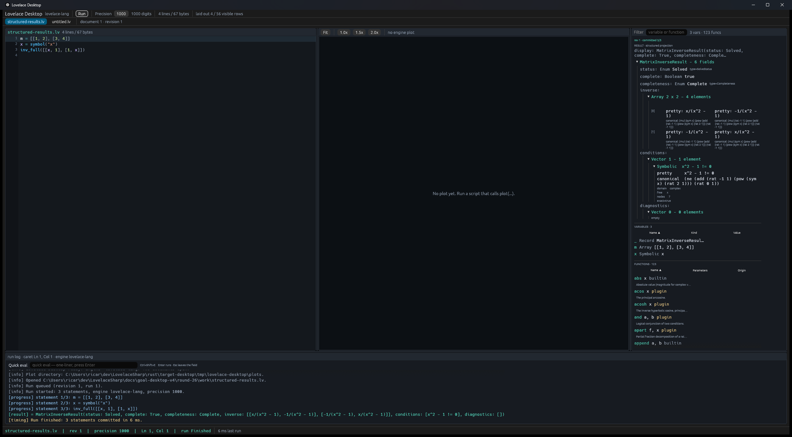

# RES-001 — recursive typed rendering of the engine's structured result

Requirement: the workbench renders the last committed value from the engine's **structured
projection**, recursively, without ever reconstructing arrays or records by parsing the pretty
display string.

## 1. What was missing

`Engine::format` gave the desktop a display string only. The engine already publishes the
structured projection (`lovelace_lang::structured::project_value`, the same `Json` the CLI runner
and the C# parity reference publish), but the desktop boundary dropped it:

1. `Evaluator::eval` returned `Result<String, String>` and `RealEngine` threw the `Value` away
   after formatting it, so no snapshot could carry the result's structure.
2. `EngineState` captured variables as `(name, kind, display)` from `Engine::capture_state`; the
   engine's own `variable_values()` values were never projected on the desktop side.
3. `WorkspaceSnapshot`/`DocumentView` had a `result: String` only, and the Workspace pane painted
   that text. Nothing rendered a tree, and there was no data a tree could truthfully be built
   from.

## 2. The data path

One projection, called by the adapter, carried end to end:

```
lovelace_lang::Engine::eval(src) -> Value
        |
        |  RealEngine::eval calls lovelace_lang::structured::project_value(&engine, &value, None)
        |  and stores the returned Json in RealEngine::last_structured
        v
Evaluator::last_structured() -> Option<Json>            (new default method: None)
        |
        |  RunWorker::execute, at the same commit point as the display text, calls
        |  engine.last_structured() and stores it in Progress::result_structured
        v
WorkspaceSnapshot { result: String, result_structured: Option<Json>, state: EngineState, .. }
        |
        |  Workbench::view copies the pair into DocumentView { result, result_structured, .. }
        v
WorkbenchApp::sync -> Workspace pane -> paint_result_section
        |
        |  ResultProjection::tree() reads `structured` only (never `display`)
        v
StructuredNode::{Array, Record, Symbolic, Scalar, Null}  ->  recursive egui tree
```

Variables take the same route (requirement 1: "each variable where the engine supplies it"):

- `EngineVariable` gained `structured: Option<Json>` (`engine.rs:192`).
- `RealEngine::state` projects **every** value from the engine's `variable_values()` through the
  engine's `structured::project_value` and attaches it to the matching captured variable
  (`engine/real.rs:105-135`). `Engine::capture_state` remains the source of name/kind/display;
  the value map is the engine's own, so the desktop reimplements no projection logic.
- `EngineState::from_legacy` and the deterministic `FakeEngine` leave the field `None`: an engine
  that publishes no projection gets an explicit empty state, never a display-derived guess.

Code points:

| Piece | Location |
| --- | --- |
| `Evaluator::last_structured` (default `None`) | `rust/lovelace-desktop/src/engine.rs:370` |
| `RunOutput.result_structured` | `rust/lovelace-desktop/src/engine.rs:278` |
| `RealEngine::last_structured` + projection at eval time | `rust/lovelace-desktop/src/engine/real.rs:30,52-69` |
| Variable projection in `RealEngine::state` | `rust/lovelace-desktop/src/engine/real.rs:105-135` |
| `WorkspaceSnapshot.result_structured` | `rust/lovelace-desktop/src/execution.rs:64` |
| Commit-time capture from `engine.last_structured()` | `rust/lovelace-desktop/src/execution.rs:722-733` |
| `DocumentView.result_structured` | `rust/lovelace-desktop/src/workbench.rs:219,1337` |
| `ResultProjection::tree` (projection only) | `rust/lovelace-desktop/src/results_tree.rs:51` |
| `StructuredNode::from_structured` | `rust/lovelace-desktop/src/results_tree.rs:78` |
| Workspace RESULT section painter | `rust/lovelace-desktop/src/ui/app.rs:1151` |
| Recursive node painter | `rust/lovelace-desktop/src/ui/app.rs:1201` |

## 3. The renderer

New module `rust/lovelace-desktop/src/results_tree.rs` (RES-001 model) and the RESULT section of
the Workspace pane (the objective permits the Workspace detail).

### 3.1 Model: the projection's vocabulary

`StructuredNode::from_structured` reads the projection's `kind` and builds:

| Projection kind | Node | What the tree keeps |
| --- | --- | --- |
| `Array` (including a `Vector`) | `ArrayNode` | `type`, `shape`, row-major `elements`; `rows()`/`cell()` for rank 2 |
| `Record` | `RecordNode` | `type` and the named `fields` array, in published order |
| `Symbolic` | `SymbolicNode` | `pretty`, `canonical`, `domain`, `freeSymbols`, `nodeCount`, `exact`, truncation |
| scalar kinds | `ScalarNode` | the published `kind`, its primary `value`/`domain`/complex pair, other fields as text |
| `Null` | `StructuredNode::Null` | absent value |

The negative-test seam is `ResultProjection`:

```rust
pub struct ResultProjection {
    pub display: String,              // label only
    pub structured: Option<Json>,     // the only structure input
}

pub fn tree(&self) -> Option<StructuredNode> {
    self.structured.as_ref().and_then(StructuredNode::from_structured)
}
```

There is no branch anywhere in the model or the painter that reads `display` to recover
structure; no `split`, `contains('[')`, or similar on the display exists in the renderer.

### 3.2 Painting

- **Arrays**: headline states the type and shape (`Array 2 x 2 - 4 elements`). A rank-2 array is
  laid out as a grid with `[0]`/`[1]` row labels and one column per cell; rank-1 arrays are an
  indexed list; higher ranks state their shape and list the row-major elements.
- **Records**: headline `MatrixInverseResult - 6 fields`; each published field name is painted
  (`status:`, `complete:`, `inverse:`, ...), scalar values inline and arrays/records/symbolics as
  indented expandable children. Every `CollapsingHeader` defaults to open, so the committed result
  is shown expanded.
- **Symbolic**: `pretty` and `canonical` are both painted (the conditions vector shows them as
  `pretty     …` / `canonical  …`, matrix cells as `pretty:` / `canonical:`), plus domain, free
  symbols and node count.
- **Scalars**: kind and value (`Natural 1`, `Enum Solved type=SolveStatus`); `Null` says so.
- The engine's display text is a one-line caption above the tree (`display: …`, full text on
  hover and in the Logs pane); it is never an input to `tree()`.
- The result tree is width-constrained to the pane so long canonical renderings wrap instead of
  clipping at the pane border.

## 4. Tests

Full log: `cargo-test.log`; baseline before the change: `baseline-test.log` (225 passed).
The suite is now **236 passed, 0 failed, 0 ignored**; 11 new tests.

| Test | What it proves | Observed |
| --- | --- | --- |
| `results_tree::tests::the_tree_reads_node_kinds_and_record_field_names_from_the_projection` | Hand-built `DivRemResult` projection: node kind `Record`, type name, and the field names `quotient`/`remainder` come from the projection; scalar kinds/values follow. | `ok` |
| `results_tree::tests::a_2x2_array_publishes_its_shape_and_rows_from_the_projection` | A 2x2 projection yields `Array`, `shape == [2,2]`, two 2-cell rows, and the four `Natural` values in row-major order. | `ok` |
| `results_tree::tests::the_display_string_cannot_change_the_rendered_tree` | **Negative test.** The display is deliberately contradictory (`DivRemResult(quotient: 9, remainder: 9) [1, 2, 3, 4]`) while the projection is a 2x2 array; two different displays produce the identical tree, it stays `Array`, has no record node, and paints `Natural 1` at `(0,0)`. | `ok` |
| `results_tree::tests::no_projection_renders_no_tree_and_never_parses_the_display` | With `structured = None` and a matrix-looking display, `tree()` is `None` (no fallback parser). | `ok` |
| `results_tree::tests::a_real_2x2_matrix_renders_its_rows_from_the_engine_projection` | Real engine `[[1, 2], [3, 4]]` → `Array`, shape `[2,2]`, values `1,2,3,4` (from `last_structured`). | `ok` |
| `results_tree::tests::a_real_record_renders_its_published_field_names` | Real engine `divrem(7, 2)` → `Record` (`DivRemResult`) with fields `quotient`,`remainder` and values `3`,`1`. | `ok` |
| `results_tree::tests::a_real_nested_record_publishes_its_fields_and_nested_matrix` | Real engine `x = symbol("x"); inv_full([[x, 1], [1, x]])` → `MatrixInverseResult` with fields `status, complete, completeness, inverse, conditions, diagnostics`, `inverse` is a 2x2 array, `conditions` is a 1-element `Vector` of symbolic expressions. | `ok` |
| `results_tree::tests::a_real_symbolic_diff_publishes_pretty_and_canonical_renderings` | Real engine `x = symbol("x"); diff(x^3 + 2*x^2 + 5*x + 7, x)` → `Symbolic` with non-empty `pretty`/`canonical`, free symbol `x`, non-zero node count. | `ok` |
| `results_tree::tests::every_captured_variable_carries_the_engine_projection` | After `m = [[1, 2], [3, 4]]` and `r = divrem(7, 2)`, `EngineState` variables carry the engine projection: `m` is a 2x2 Array, `r` is `DivRemResult - 2 fields`. | `ok` |
| `workbench::tests::the_real_snapshot_publishes_the_structured_result_and_variable_projections` | End to end through the real desktop run: `WorkspaceSnapshot`/`DocumentView` carry `result_structured`, the tree renders `MatrixInverseResult` with a 2x2 `inverse`, and the captured variable `m` carries the same projection (`Natural 4` at `(1,1)`). | `ok` |
| `ui::app::tests::the_result_section_paints_the_projection_and_never_parses_the_display` | Paint-layer negative test: a contradictory record-like display attached to a 2x2 projection; the painted text carries `Array 2 x 2 - 4 elements`, `Natural`, `1..4`, and contains no record header or `quotient:` field label. | `ok` |

Observed lines (from `cargo-test.log`):

```
test results_tree::tests::the_display_string_cannot_change_the_rendered_tree ... ok
test results_tree::tests::a_real_2x2_matrix_renders_its_rows_from_the_engine_projection ... ok
test results_tree::tests::a_real_record_renders_its_published_field_names ... ok
test results_tree::tests::a_real_nested_record_publishes_its_fields_and_nested_matrix ... ok
test results_tree::tests::a_real_symbolic_diff_publishes_pretty_and_canonical_renderings ... ok
test results_tree::tests::every_captured_variable_carries_the_engine_projection ... ok
test workbench::tests::the_real_snapshot_publishes_the_structured_result_and_variable_projections ... ok
test ui::app::tests::the_result_section_paints_the_projection_and_never_parses_the_display ... ok
```

The focused negative test also pins the ambiguity explicitly:

```
display = "DivRemResult(quotient: 9, remainder: 9) [1, 2, 3, 4]"
structured = { kind: "Array", shape: [2, 2], elements: [1, 2, 3, 4] }
tree kind == "Array"; rows == 2; cell(0,0).headline() == "Natural 1";
no node has kind "Record"
```

## 5. Window proof

**Method.** The console session was **unlocked** (no `LogonUI`; interactive session 1), so this
used the normal harness `tools/gui-harness.ps1` for launch, UI Automation invocation, UIA tree and
screen capture, plus `PrintWindow(hwnd, hdc, PW_RENDERFULLCONTENT)` for the full 2500x1380 frame.
`tools/` was not modified. Script: `capture-structured-results.ps1`; driver log:
`work/driver.log`.

Steps:

1. `work/structured-results.lv` (67 bytes): `m = [[1, 2], [3, 4]]`,
   `x = symbol("x")`, `inv_full([[x, 1], [1, x]])`.
2. Launched `rust/target-desktop/debug/lovelace-desktop.exe work/structured-results.lv` through
   `-Action launch`; `SetWindowPos` restored it to 2500x1380 at (0,0), inside the 2560x1440
   desktop.
3. Invoked **Run** through UI Automation `InvokePattern` (`-Action click -Name Run`); no typing.
4. Polled the live status until
   `structured-results.lv | rev 1 | precision 1000 | Ln 1, Col 1 | run Finished`.
5. Dumped the live accessibility tree (`structured-results-uia.txt`, 40,566 bytes, 600 nodes) and
   asserted the projection's vocabulary is present: `MatrixInverseResult - 6 fields`,
   `Array 2 x 2 - 4 elements`, all six field labels, `pretty`/`canonical` (5 each), `Symbolic`,
   `[[1, 2], [3, 4]]`, and `run Finished`.
6. Took the harness `-Action capture` PNG (CopyFromScreen of the fully visible window) and the
   `PrintWindow` PNG; both were opened and inspected. The PrintWindow frame's exact colours were
   probed (sampled every 2 px): accent `4EC9B0` = 255, text `D8DEE9` = 136, dim `8B98A9` = 474,
   warn `D7BA7D` = 46.

Artifacts:



| File | Size (bytes) | Dimensions | What |
| --- | --- | --- | --- |
| `structured-results-printwindow.png` | **428,557** | 2500x1380 | **The proof image**: PrintWindow frame. Workspace RESULT section shows the nested record expanded: `▼ MatrixInverseResult - 6 fields` with `status: Enum Solved`, `complete: Boolean true`, `completeness: Enum Complete`, `inverse:` → `▼ Array 2 x 2 - 4 elements` with `[0]`/`[1]` rows of symbolic `pretty:` + `canonical:` cells, `conditions:` → `▼ Vector 1 - 1 element` → `▼ Symbolic x^2 - 1 != 0` with pretty/canonical/domain/free/nodes, and `diagnostics:` → `▼ Vector 0 - 0 elements / empty`. VARIABLES below it shows `_ Record MatrixInverseRes…`, `m Array [[1, 2], [3, 4]]`, `x Symbolic x`. Status strip `run Finished`. |
| `structured-results.png` | 433,243 | 2500x1380 | Harness `-Action capture` frame of the same run/window. |
| `structured-results-uia.txt` | 40,566 | — | Live UIA tree (also `work/uia-tree.txt`). |
| `capture-run.log` | 1,540 | — | Script output: pid/hwnd, resize, status, counts, capture sizes, probe. |
| `work/driver.log` | 1,115 | — | Harness launch / wait / click / status / UIA / capture timings. |
| `work/structured-results.lv` | 67 | — | The 3-statement script. |
| `capture-structured-results.ps1` | 10,729 | — | Reproducible driver (PS 5.1, ASCII). |

### UIA excerpt (the rendered tree's structure)

```
Text | RESULT · structured projection
Text | display: MatrixInverseResult(status: Solved, complete: True, completeness: Comple…
Button | MatrixInverseResult - 6 fields
Text | status:
Text | Enum
Text | complete:
Text | Boolean
Text | completeness:
Text | Enum
Text | inverse:
Button | Array 2 x 2 - 4 elements
Text | pretty: x/(x^2 - 1)
Text | canonical: (mul (sym x) (pow (add (rat -1 1) (pow (sym x) (rat 2 1))) (rat -1 1)))
Text | pretty: -1/(x^2 - 1)
Text | canonical: (mul (rat -1 1) (pow (add (rat -1 1) (pow (sym x) (rat 2 1))) (rat -1 1)))
... (two more cells)
Text | conditions:
Button | Symbolic  x^2 - 1 != 0
Text | pretty     x^2 - 1 != 0
Text | canonical  (ne (add (rat -1 1) (pow (sym x) (rat 2 1))) (rat 0 1))
Text | diagnostics:
Text | m
Text | [[1, 2], [3, 4]]
Text | run Finished
```

The `display:` caption is the engine's text, truncated for the caption only; every structure
above comes from `result_structured`/`DocumentView`. The display line in the log still reads
`= MatrixInverseResult(...)`, unchanged.

## 6. Suite summary

```
$ cargo test -p lovelace-desktop --manifest-path rust/Cargo.toml
test result: ok. 236 passed; 0 failed; 0 ignored; 0 measured; 0 filtered out; finished in 1.16s
```

- Baseline before the round: 225 passed (`baseline-test.log`).
- New: 11 tests (§4), including the model negative test and the paint-layer negative test.
- `cargo test --no-default-features --no-run` compiles the test binary
  (`no-default-features-build.log`).
- No engine crate was modified; `structured::project_value` and `Engine::variable_values` are
  called from the desktop's real-engine adapter, not reimplemented.
